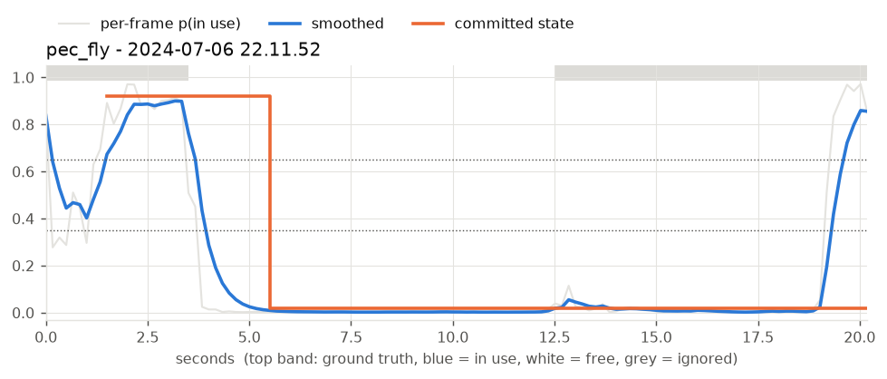
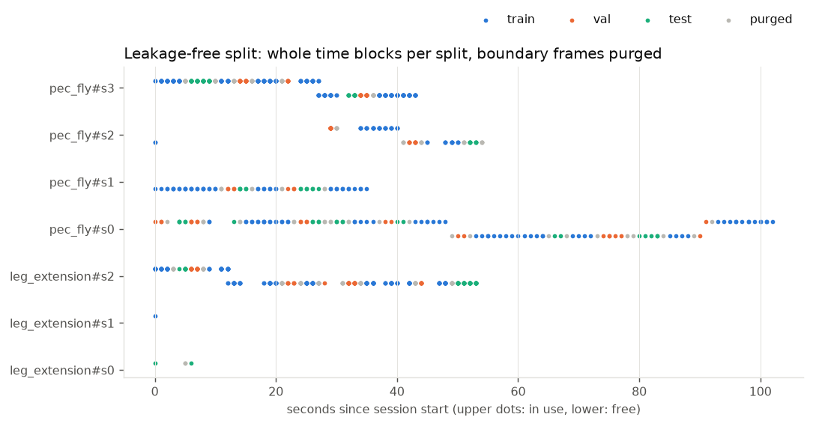
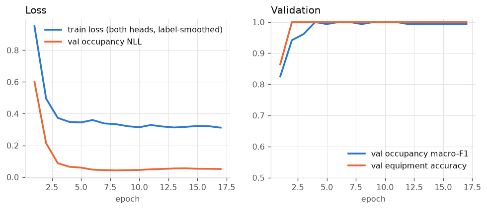
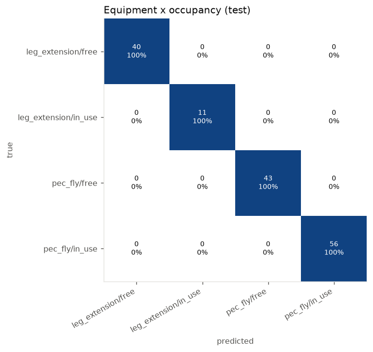
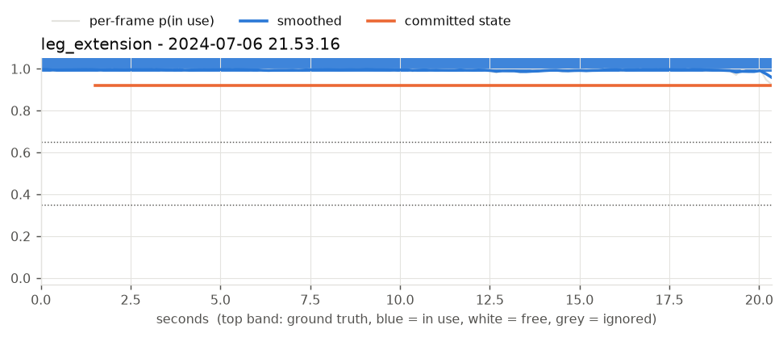

# GymWatch: Real-Time Gym Equipment Monitoring

GymWatch watches camera feeds of gym machines and reports, live, whether each machine is
**in use** or **free**. It also logs every usage session and serves a dashboard with
utilisation statistics.

It is a full rewrite of a 2024 Keras notebook project. The data is a
**self-collected dataset**: 1,062 phone photos and two videos of a leg-extension machine and a
pec-fly machine. The data stays private and is not included in this repository.

```
camera / video ──► FrameSource ──► batched ONNX inference ──► OccupancyTracker ──► SQLite sessions
   (per camera,      (thread,         (all cameras, one        (EMA + hysteresis     │
    paced, auto-      latest frame)    call, ~11 ms/frame CPU)   + min dwell)         ▼
    reconnect)                                                        └──► FastAPI: dashboard, MJPEG,
                                                                             REST, SSE, /metrics
```

## Highlights

- **Leakage-free evaluation.** The photos are 10 fps bursts. A random split (what the original
  did) gives **90%** of held-out images a training twin taken in the *same second*. GymWatch
  splits by time blocks and purges boundary frames, so **0%** of held-out images have a
  training frame within 1 s.
- **Multi-task model.** A MobileNetV4 backbone has an *occupancy* head and an *equipment*
  head. The equipment head flags a camera that has been moved to point at the wrong machine.
- **Temporal state machine.** An exponential moving average, hysteresis thresholds and a
  minimum dwell time turn flickering per-frame scores into stable states. Session boundaries
  are back-dated to when the change actually began.
- **Deployable.** The ONNX model is 34 MB (the legacy model was 486 MB) and runs without
  PyTorch. Inference takes about 11 ms per 1080p frame on a laptop CPU. The Docker image is
  inference-only.
- **Measured honestly.** Results cover a held-out test split, 5-fold grouped cross-validation,
  leave-one-capture-session-out, and hand-annotated video. A from-scratch baseline is included
  for comparison.

## Results

All numbers come from `bash scripts/reproduce.sh` (about 15 minutes on an RTX 4060 laptop GPU).

### Image classification

| Evaluation | Pretrained init (default) | From scratch |
|---|---|---|
| Held-out test split (150 images), occupancy accuracy | **100%** | **100%** |
| 5-fold grouped CV, occupancy accuracy | **99.6% ± 0.6%** | 98.9% ± 1.6% |
| 5-fold grouped CV, occupancy ROC-AUC | **0.9999** | 0.992 |
| Equipment accuracy (test and CV) | 100% | 100% |
| Calibration error (ECE, test) before → after temperature scaling | 0.039 → **0.002** | 0.031 → 0.001 |

### Leave-one-session-out (a new capture session never seen in training)

| Held-out session | Images | Pretrained acc / AUC | Scratch acc / AUC |
|---|---|---|---|
| Pec fly, 2024-07-06 22:10 | 139 | 100% / 1.000 | 99.3% / 1.000 |
| Pec fly, 2024-07-06 22:14 (machine empty) | 72 | 100% / n/a | 100% / n/a |
| Pec fly, 2024-07-06 22:21 | 96 | 100% / 1.000 | 100% / 1.000 |
| Pec fly, **2024-07-11 (different day)** | 388 | **100% / 1.000** | 99.7% / 1.000 |
| Leg extension, 2024-07-10 (main leg session) | 362 | 39.8% / **0.996** | 72.9% / 0.357 |

The last row is the most informative. With its main session held out, the model has seen only
5 leg-extension photos, all of them "in use".

- **Pretrained model:** it still *ranks* occupied above empty almost perfectly (AUC 0.996).
  Only its decision threshold is off for an almost-unseen machine. A few labelled frames, or a
  per-camera threshold (`cameras[].smoothing` in the config), fix that.
- **Scratch model:** its 72.9% is just "predict free" on a mostly-empty session, and its
  AUC of 0.357 is worse than chance.

This is the main argument for the pretrained initialisation.

### Live pipeline on annotated video

The deployed ONNX model and tracker run over both clips at 6 inferences per second, scored
against [hand labels](configs/video_labels.yaml). Frames showing someone leaning over to adjust
the seat never appear in the photo set, so they are marked *ignore* and excluded from scoring.

| Clip | Scored frames | Per-frame | Live state | Logged history | Flips (raw → smoothed) |
|---|---|---|---|---|---|
| Leg extension (in use throughout) | 123 | 100% | 92.7%¹ | **100%** | 0 → 0 |
| Pec fly (walks off, machine empty, returns) | 54 | 98.1% | 77.8%² | **94.4%** | **6 → 1** |

¹ The first 1.5 s is warm-up, before a state is committed.
² The live state switches to "free" about 2 s after the person leaves: the EMA plus the 1.5 s
dwell. That delay is the price of suppressing flicker. The *logged* session end is back-dated,
which is why the stored history is far more accurate than the live display.



### Figures

| | |
|---|---|
|  |  |
|  |  |

Grad-CAM (written locally to `docs/figures/private/`, kept out of git because it shows dataset
photos) confirms that the occupancy head looks at the seat and the seated person, not at the
background.

## Quick start

Requirements: Python 3.12 and [uv](https://docs.astral.sh/uv/). An NVIDIA GPU is optional; it
is used only for training.

```bash
uv sync                                  # PyTorch (CUDA 12.8 wheels on Windows/Linux) + deps
uv run gymwatch prepare                  # manifest + image cache + leakage-free split
uv run gymwatch train --name pretrained  # ~1 min on GPU
uv run gymwatch evaluate runs/pretrained # test metrics + figures in runs/pretrained/report/
uv run gymwatch export runs/pretrained   # -> models/gymwatch.onnx (with parity check)
uv run gymwatch serve                    # http://127.0.0.1:8000
```

Expected data layout (folder names are the labels):

```
data/
  IN-USE-LEG-EXTENSION/   NOT-IN-USE-LEG-EXTENSION/
  IN-USE-PEC-FLY/         NOT-IN-USE-PEC-FLY/
video/
  2024-07-06 21.53.16.mov  2024-07-06 22.11.52.mov
```

### Commands

| Command | What it does |
|---|---|
| `prepare` | Decodes each photo once (JPEG draft mode and EXIF orientation), caches it at 384 px, and assigns train/val/test/purged |
| `train` | AdamW, warmup and cosine LR, bf16 autocast, EMA weights, class-balanced sampling, early stopping, temperature scaling |
| `evaluate` | Test metrics (accuracy, macro-F1, AUC, ECE, NLL, Brier), confusion matrices, reliability plot, Grad-CAM |
| `cv --by block\|session` | Grouped, purged 5-fold CV, or leave-one-capture-session-out |
| `export` | ONNX export with embedded metadata (labels, input size, temperature) and a numerical parity check |
| `video-eval` | Runs the deployed predictor and tracker over annotated videos |
| `predict IMG...` | Classifies individual images |
| `monitor` | Headless live monitor in the terminal |
| `serve` | API and dashboard |
| `bench` | Preprocessing and inference latency |

Any config value can be overridden on the command line, e.g.
`-s train.epochs=10 -s model.pretrained=false`.

### Training data and "nothing from the internet"

Only the self-collected photos are used for training and evaluation; no external dataset is
used. By default the backbone starts from ImageNet weights (`model.pretrained: true`), which
timm downloads once. To use no externally trained weights at all, set
`model.pretrained: false`. The tables above show what that costs.

## API

| Endpoint | |
|---|---|
| `GET /` | Live dashboard (self-contained, no CDN, light and dark themes) |
| `GET /api/cameras` | Current state of every camera |
| `GET /api/events` | Server-sent events: a camera snapshot every 500 ms |
| `GET /api/cameras/{id}/stream.mjpg` | Annotated MJPEG stream |
| `GET /api/cameras/{id}/frame.jpg` | Latest annotated frame |
| `GET /api/cameras/{id}/history?seconds=60` | Raw and smoothed probability series |
| `GET /api/sessions` | Logged usage sessions |
| `GET /api/stats?window_s=3600` | Utilisation, session count and mean duration per machine |
| `POST /api/predict` | Classify an uploaded image |
| `GET /api/health`, `GET /metrics` | Health check (with model metadata) and Prometheus metrics |

### Adding a camera

Add an entry to [`configs/default.yaml`](configs/default.yaml):

```yaml
monitor:
  cameras:
    - id: pec-fly-2
      name: Pec fly (back row)
      source: rtsp://192.168.1.20:554/stream1   # or a file path, or "0" for a webcam
      equipment: pec_fly
      roi: [0.1, 0.0, 0.9, 1.0]                  # optional crop, as fractions of the frame
      smoothing: {enter_threshold: 0.8, exit_threshold: 0.4, min_dwell_s: 2.0, ema_alpha: 0.35}
```

Network sources reconnect with exponential backoff. Video files play back in real time, so a
recording behaves like a live camera.

## Docker

```bash
uv run gymwatch export runs/pretrained      # the image needs models/gymwatch.onnx
docker build -t gymwatch .
docker run -p 8000:8000 -v "$PWD/video:/app/video" gymwatch
```

The image contains ONNX Runtime, OpenCV and FastAPI only: no PyTorch and no training data.

## File structure

```
Real-Time-Gym-Equipment-Monitoring-System/
├── .github/workflows/ci.yml     lint + tests on every push (CPU, synthetic data)
├── configs/
│   ├── default.yaml             all settings: data, model, training, cameras, smoothing
│   └── video_labels.yaml        hand-annotated ground truth for video evaluation
├── data/                        YOUR PHOTOS (private, not in the repo; see data/README.md)
│   ├── IN-USE-LEG-EXTENSION/
│   ├── NOT-IN-USE-LEG-EXTENSION/
│   ├── IN-USE-PEC-FLY/
│   └── NOT-IN-USE-PEC-FLY/
├── video/                       YOUR VIDEOS (private, not in the repo; see video/README.md)
├── models/                      exported gymwatch.onnx (generated, not in the repo)
├── docs/figures/                charts used in this README
├── scripts/
│   ├── reproduce.sh             reruns every experiment in the Results section
│   └── serve.py                 server entry point for the Docker image
├── src/gymwatch/
│   ├── cli.py                   the `gymwatch` command
│   ├── config.py                typed YAML config (pydantic) with CLI overrides
│   ├── labels.py                folder name -> (equipment, occupancy)
│   ├── data/
│   │   ├── manifest.py          scan, EXIF fix, capture time, sessions, image cache
│   │   ├── split.py             grouped + purged split, CV folds, leakage report
│   │   └── dataset.py           PyTorch dataset, augmentation, balanced sampler
│   ├── model.py                 multi-task GymNet (timm backbone) + checkpoints
│   ├── train.py                 training loop
│   ├── metrics.py               metrics, calibration error, temperature scaling
│   ├── export.py                ONNX export + parity check
│   ├── preprocess.py            NumPy/OpenCV preprocessing shared by eval and deployment
│   ├── predictor.py             ONNX Runtime predictor (no PyTorch needed)
│   ├── video.py                 offline video analysis and scoring
│   ├── report.py                figures and Grad-CAM
│   ├── realtime/
│   │   ├── sources.py           camera / RTSP / video-file readers
│   │   ├── tracker.py           smoothing + hysteresis state machine
│   │   ├── store.py             SQLite session log and usage stats
│   │   ├── render.py            on-frame status overlay
│   │   └── hub.py               multi-camera loop with batched inference
│   └── api/
│       ├── __init__.py          FastAPI app (REST, SSE, MJPEG, /metrics)
│       └── static/              dashboard (HTML/CSS/JS, no CDN)
├── tests/                       unit + integration tests (no private data needed)
├── Dockerfile                   inference-only image
├── pyproject.toml               dependencies and tool settings
├── uv.lock                      pinned dependency versions
└── LICENSE                      MIT
```

Created locally when you run the pipeline (git-ignored): `.cache/` (resized images),
`artifacts/` (split manifest, video results, session database) and `runs/` (checkpoints,
metrics and figures for each training run).

## Development

```bash
uv run pytest            # 26 tests: splitting, tracker, store, ONNX parity, API
uv run ruff check src tests
uv run ruff format src tests
```

CI (GitHub Actions) runs lint and tests on CPU. The tests use synthetic data, so the private
dataset is never needed.

## Limitations

- **Two machines, one gym, one person.** The results show the pipeline works, not that it
  generalises to any gym. A new machine needs some labelled frames; see the leave-one-session-out
  results.
- **Small test split.** The held-out split has 150 images, so 100% means "no errors seen", not
  "no errors possible". The CV and session-level numbers are the more reliable estimates.
- **Ambiguous behaviour is untested.** Leaning over a machine to adjust it, or resting between
  sets, was never labelled.
- **Live-state latency.** The live state lags real changes by about 1.5–2 s with the default
  smoothing. Tune `monitor.smoothing` to trade latency against flicker.
